<div align="center">

<picture>
  <source media="(prefers-color-scheme: dark)" srcset="site/src/assets/hero-dark.svg">
  
</picture>

# HALO

**Harness for Always-On Loop Oversight**

<p>
  <a href="https://always-on-intelligence.github.io/HALO/"></a>
  <a href="https://always-on-intelligence.github.io/Always-On_Personal_Intelligence.pdf"></a>
  <a href="https://always-on-intelligence.github.io/"></a>
</p>

<p>
  <a href="https://github.com/Always-On-Intelligence/HALO/stargazers"></a>
  
  
  <a href="LICENSE"></a>
</p>

<a href="#overview">Overview</a> · <a href="#mcp-plugin">MCP plugin</a> · <a href="#setup">Setup</a> · <a href="#read-mode">Read mode</a> · <a href="#run-mode">Run mode</a> · <a href="#our-results">Results</a> · <a href="#cases">Cases</a> · <a href="#citation">Citation</a>

</div>

<br>

## Overview

HALO is a diagnostic tool that assesses the loop completeness of existing always-on assistants. It
follows the framework of the survey [*Always-On Personal Intelligence*](https://always-on-intelligence.github.io/Always-On_Personal_Intelligence.pdf): an always-on assistant runs a
continuing loop of three functional modules, **Sensing**, **Memory**, and **Action**, connected by six
directed coupling channels, and self-evolution extends this loop when the assistant revises how it
works from its own operating experience.

HALO examines two parts of this framework: the coupling channels of the continuing loop and, for
self-evolution that rests on outcome feedback, the five steps of the chain of evidence. For each
channel or step, it asks two questions and answers them in two modes.

<table>
  <tr>
    <th width="50%" align="left">Read mode<br><sub>Does a system's source report it?</sub></th>
    <th width="50%" align="left">Run mode<br><sub>Does removing it change the system's behavior?</sub></th>
  </tr>
  <tr>
    <td valign="top">Three oversight agents, language-model coding agents with web access, each read a work's papers and released code on their own and judge every coupling channel and every evidence step with a quote and a locator. A majority vote decides each cell.</td>
    <td valign="top">HALO runs a system's released code on fixed inputs, once unmodified and once with one or more channels or evidence steps removed, and examines how its behavior changes. The model clients call one backbone that stays fixed across arms, and each case's README says what else its adapter replaces.</td>
  </tr>
</table>

The five steps are record, outcome, attribution, revision, and later use. For an email assistant that
learns from the user's edits, as EAIA does:

| Record | Outcome | Attribution | Revision | Later use |
|:---:|:---:|:---:|:---:|:---:|
| the draft it wrote | the user's edit | links the edit to that draft | rewrites the drafting prompt | the next draft, written with the new prompt |

> [!NOTE]
> The word harness in the name refers to these two modes of analysis, not to the harness inside an
> assistant's scaffolding.

## MCP plugin

HALO also works as an **MCP plugin** for agents that are already running, such as ChatGPT dots, Grok Bot,
Claude Code, or Codex. The agent logs each step of its loop to HALO, naming the earlier steps it used, and
HALO reads the channels, the evidence steps, and the loop-closure level the trace supports from those links:

```bash
uv pip install -p .venv/bin/python -e ".[mcp]"
halo serve                      # stdio, for local hosts
halo serve --http --port 8765   # Streamable HTTP
halo trace report <agent>       # the diagnosis of one agent's trace
```

Any MCP client can start it with:

```json
{
  "mcpServers": {
    "halo": { "command": "halo", "args": ["serve"] }
  }
}
```

The [documentation](https://always-on-intelligence.github.io/HALO/), built from `site/` (an Astro Starlight
site), explains the plugin's architecture, how to connect each host, and the MCP tools.

## What is in this repository

```
halo/                 the package
  mcp/                the MCP plugin: server, ledger, analysis, and `halo trace`
  backends/           model calls through local coding-agent CLIs (Codex, Claude Code)
  read/               read mode: protocol, review, batch, vote, tables
  run/                run mode: adapter base class, worker, harness, judge, cached LLM
cases/<work>/         one folder per reviewed work (40 works)
  case.yaml           the configuration reviewed, its sources, and its code
  core/               the upstream code that run mode executes, copied unchanged
  adapter.py          connects the upstream code to the harness and defines the cut sites
  run.yaml, inputs/   the run-mode tests and their scripted inputs
results/read/         our read-mode reviews, votes, per-work counts, and the table
results/run/          our run-mode reports
docs/                 how to add a case or connect your own system
site/                 the documentation site for the plugin
scripts/              cloning the upstream repositories, generating case files
```

## Setup

```bash
uv venv .venv -p 3.11
uv pip install -p .venv/bin/python -e .
```

Models are called through local CLIs, so no API key is stored in the repository. Point HALO at
them with environment variables:

```bash
# backend names codex:<model>, e.g. codex:gpt-6-astra
export HALO_CODEX_BIN=/path/to/codex
# backend names claude:<model>, e.g. claude:claude-opus-5-5
export HALO_CLAUDE_BIN=/path/to/claude
```

Each call runs without the local account's own configuration, memories, or rules
(`halo/backends/cli.py`).

## Read mode

```bash
python scripts/clone_upstream.py                         # code the agents read, at pinned commits
halo read --backend codex:gpt-6-astra --workers 6        # one oversight agent over all works
halo read --backend claude:claude-opus-5-5 --workers 6
halo read --backend claude:claude-fable-5-1 --workers 6

halo vote      # results/read/votes.json, disagreements.md
halo tables    # results/read/table.md, table.csv, counts.json
```

The protocol every agent follows is `halo/read/protocol/PROTOCOL.md`, and every review must
validate against `halo/read/schema.json`.

## Run mode

```bash
uv venv cases/aiget/.venv -p 3.11
uv pip install -p cases/aiget/.venv/bin/python -r cases/aiget/requirements.txt
halo run cases/aiget --workers 4
```

The harness writes `runs/<case>/<name>/` with every arm's output (`arms.jsonl`), the judge's
verdicts (`judge.jsonl`), and a summary (`report.md`, `report.json`). Model replies are cached,
so arms whose prompts are identical share them and a rerun costs nothing.

## Our results

### Read mode

Three oversight agents reviewed all 41 configurations of the 40 works: GPT-6-Astra (Codex CLI, reasoning effort
ultra), Claude Opus 5.5 and Claude Fable 5.1 (Claude Code CLI, effort max). Counts over 40 works, from the
majority vote (`results/read/counts.json`; a work with several configurations counts once):

| | S→M | M→A | A→S | M→S | A→M |
|---|:---:|:---:|:---:|:---:|:---:|
| reported | 38 | 40 | 30 | 25 | 31 |
| insufficient | 0 | 0 | 8 | 13 | 7 |
| absent | 2 | 0 | 2 | 2 | 2 |

Evidence steps stated:

| record | outcome | attribution | revision | later use |
|:---:|:---:|:---:|:---:|:---:|
| 30 | 20 | 26 | 6 | 3 |

19 works report A→M and also retain outcomes.

Every review, with quotes and locators, is in `results/read/reviews/<agent>/`; the vote is in
`results/read/votes.json`, the cells without a unanimous vote in `results/read/disagreements.md`, and the
table in `results/read/table.md`.

### Run mode

20 works run in the harness. Of the two other works with a code link, IPI-Agent's agent code is not
released, and STRANDS is a ROS 1 robot stack without a single entry point for the service loop. Each
case was run with GPT-6-Astra as the backbone (effort low) and as the blind judge (effort high), with 3
samples per item. Each case's `report.md`, every arm's output (`arms.jsonl`), and the judge's verdicts
(`judge.jsonl`) are in `results/run/<case>/`. The case README says what was replaced and why.

## Cases

<details>
<summary><b>All 40 works</b>, 20 of them run in the harness</summary>

<br>

| Work | Domain | Kind | Code | Run mode |
|---|---|---|---|---|
| [ABot-Claw](cases/abot-claw/) | physical | research | yes | 6 tests |
| [AiGet](cases/aiget/) | wearable | research | yes | 4 tests |
| [Alpha-Service](cases/alpha-service/) | wearable | research | no | no code |
| [AssistantX](cases/assistantx/) | physical | research | yes | 4 tests |
| [AwareLLM](cases/awarellm/) | digital | research | no | no code |
| [Bee](cases/bee/) | wearable | product | no | no code |
| [ContextAgent](cases/contextagent/) | wearable | research | yes | 1 test |
| [Dot](cases/dot/) | digital | product | no | no code |
| [EAIA](cases/eaia/) | digital | product | yes | 5 tests |
| [Egocentric Co-Pilot](cases/egocentric-copilot/) | wearable | research | yes | 3 tests |
| [ElliQ](cases/elliq/) | physical | product | no | no code |
| [Hobbit](cases/hobbit/) | physical | research | no | no code |
| [IPI-Agent](cases/ipi-agent/) | wearable | research | yes | agent code not released |
| [LightMem-Ego](cases/lightmem-ego/) | wearable | research | yes | 3 tests |
| [Long-term TOA](cases/long-term-toa/) | digital | research | no | no code |
| [M3-Agent](cases/m3-agent/) | wearable | research | yes | 3 tests |
| [Memento](cases/memento/) | wearable | research | no | no code |
| [MoveCare](cases/movecare/) | physical | research | no | no code |
| [Muse](cases/muse/) | digital | product | no | no code |
| [Omi](cases/omi/) | wearable | product | yes | 5 tests |
| [Ouroboros](cases/ouroboros/) | digital | research | yes | 11 tests |
| [PAHF](cases/pahf/) | digital | research | yes | 8 tests |
| [PASK](cases/pask/) | digital | research | yes | 2 tests |
| [PHILIA](cases/philia/) | physical | research | no | no code |
| [PITCH](cases/pitch/) | digital | research | no | no code |
| [Plan, Watch, Recover](cases/plan-watch-recover/) | wearable | research | no | no code |
| [Pro²Assist](cases/pro2assist/) | wearable | research | no | no code |
| [ProAct](cases/proact/) | digital | research | yes | 5 tests |
| [Proactive Agent](cases/proactive-agent/) | digital | research | yes | 3 tests |
| [ProAgent](cases/proagent/) | wearable | research | no | no code |
| [ProPerAssistant](cases/properassistant/) | digital | research | yes | 7 tests |
| [Sensible Agent](cases/sensible-agent/) | wearable | research | no | no code |
| [SocialMind](cases/socialmind/) | wearable | research | no | no code |
| [SpeechLess](cases/speechless/) | wearable | research | no | no code |
| [STRANDS](cases/strands/) | physical | research | yes | not integrated (ROS 1 robot stack) |
| [User as Code](cases/user-as-code/) | digital | research | yes | 3 tests |
| [Vinci](cases/vinci/) | wearable | research | yes | 2 tests |
| [Vinci2](cases/vinci2/) | wearable | research | yes | 3 tests |
| [VisionClaw](cases/visionclaw/) | wearable | research | yes | 4 tests |
| [VisualClaw](cases/visualclaw/) | digital | research | yes | 8 tests |

</details>

## Connect your own system

Write a case folder for it: an adapter that runs your code with its model client pointed at the
HALO backbone, the sites where each channel or evidence step can be cut, and a few scripted
inputs. `docs/adding_a_case.md` gives the rules, and `cases/aiget/` is the reference case.

## Citation

HALO is introduced in the survey below. If you use it, please cite:

```bibtex
@misc{alwayson2026roadmap,
  title  = {Always-On Personal Intelligence: A Roadmap Towards
            Continuing, Self-Evolving Loops},
  author = {Liu, Shuai and Guo, Hongming and Jin, Weiyang and Hu, Kairui and
            Tian, Shulin and Dong, Yuhao and Wu, Jinming and Zhang, Kaichen and
            Tang, Yujin and Han, Xinyang and Chai, Wenhao and Fu, Yuqian and
            Zhang, Ce and Zhang, Yuanhan and Kong, Lingdong and Siyao, Li and
            Yang, Jingkang and Bertasius, Gedas and Li, Manling and Wu, Jiajun and
            Wang, Mengdi and Song, Dawn and Liu, Ziwei},
  year   = {2026},
  note   = {Working draft},
  url    = {https://always-on-intelligence.github.io/}
}
```

## Acknowledgments

We thank [LMMs-Lab](https://www.lmms-lab.com/) for the idea and inspiration behind our documentation.

## License

HALO's own code is under the [MIT License](LICENSE). The code under `cases/*/core/` comes from each work's
own repository and keeps that repository's terms. Where a repository states no license, its authors keep
their rights.
